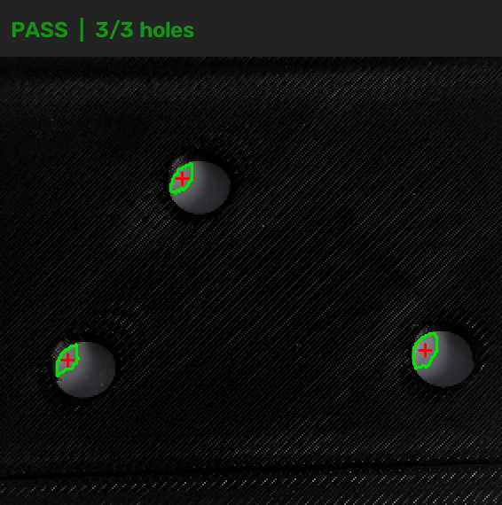
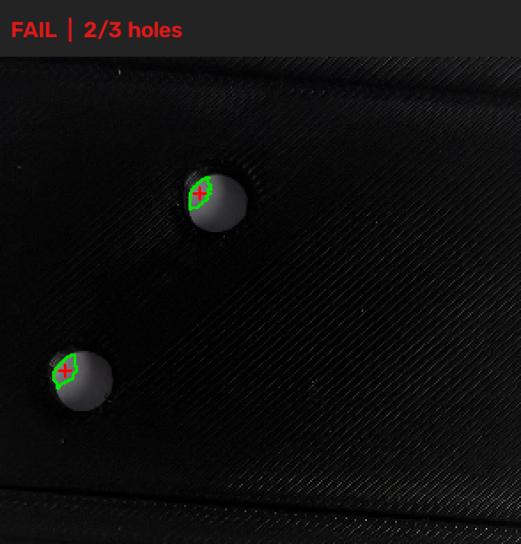

# Vision-Based Inspection of 3D-Printed Mounting Plates

**Python · OpenCV · 3D printing · Computer vision · Quality inspection**

A proof-of-concept vision inspection system that classifies 3D-printed mounting plates as **PASS** or **FAIL** based on the number of visible holes and the relative geometry of a three-hole pattern. The project combines a physical inspection fixture with a Python/OpenCV image-processing pipeline and automated CSV reporting.

> **Prototype, not a calibrated metrology system.** The checks use pixel-derived geometry and empirical thresholds, not dimensional tolerances in millimetres.

## Inspection examples

| Nominal plate — PASS | Defective plate — FAIL |
|:---:|:---:|
|  |  |
| Three detected holes with a matching relative pattern. | Two detected holes; the required third hole is absent. |

Green contours mark the *bright portions* of detected openings; red crosses mark the resulting contour centroids. These overlays are not measurements of the full hole boundaries or diameters.

## Project objective

Explore how a low-cost computer vision workflow could automate a simple visual quality check. A black-PLA printed fixture holds each plate against a white-paper background. A smartphone captures overhead photographs, and Python processes the images and records inspection decisions.

**Hardware:** 3D-printed fixture and nominal/defective plate samples, white-paper backing, smartphone camera. The physical parts were produced on a Creality K1C 3D printer.

**Software:** Python, OpenCV, and standard-library modules for CSV/JSON data handling.

## How the inspection works

1. **Locate the fixture.** Resize the photograph, threshold dark pixels, and select the largest dark contour as a candidate fixture region.
2. **Crop the inspection area.** Extract a proportionally defined region of interest inside the fixture bounding box.
3. **Find visible holes.** Threshold bright pixels within the crop, find contours, discard very small regions, and calculate a centroid for each detected region.
4. **Check hole count.** A nominal plate must contain **exactly three** detected openings.
5. **Compare relative pattern geometry.** For a three-hole candidate, calculate the three pairwise centroid distances, sort them, and divide each by the longest distance. Compare these ratios against the reference pattern derived from nominal photographs. This reduces sensitivity to image rotation and uniform changes in camera distance.
6. **Record the decision.** Save an annotated PNG, a PASS/FAIL decision, and per-image measurements to a CSV file.

The current prototype uses an empirically selected hole-brightness threshold of **100** and a relative side-ratio difference limit of **3 percentage points**. These are software-development parameters, **not** manufacturing specifications.

## Results and iteration

| Evaluation stage | Result | What it means |
|---|---:|---|
| Version 4, 11 captured photos | **10/11** correct | One handheld nominal image was falsely rejected despite detecting all three holes. |
| Version 5, same 11 development photos | **11/11** correct | Relative triangle-side ratios resolved that observed orientation/alignment-related failure. |
| Version 5, two *new* handheld photos | **2/2** correct | One nominal PASS and one missing-hole FAIL, captured after the Version 5 algorithm was selected. |

**Version 5 classified 13/13 tested photographs correctly in total**, but the 11 development photographs were used during iteration and parameter selection. Only the final two photographs were fresh after that version was chosen. The test also reused the same physical nominal and defective plates, so these results **do not establish population accuracy or industrial reliability**.

An earlier prototype also exhibited a false rejection under changed lighting. The bright-pixel threshold was adjusted from 160 to 100 after examining that failure. The previous outcomes were retained as part of the design iteration, rather than presented as successful independent tests.

## Run locally

1. Install a recent Python version.
2. Create and activate a virtual environment (example for macOS/Linux):

   ```bash
   python3 -m venv .venv
   source .venv/bin/activate
   pip install -r requirements.txt
   ```

3. Place the original test photographs in a `photos/` folder. The current script's `TRIALS` list specifies the **11 development-image filenames** it expects. To inspect different photos, update that list with the photo filenames and correct nominal/defective labels.
4. Run:

   ```bash
   python bracket_inspection.py
   ```

5. Review the generated files in `results_v5/`:
   - `inspection_results.csv` — classifications and pattern-check measurements.
   - `*_annotated.png` — cropped photographs with detection overlays.

The reference coordinates are loaded from `hole_reference.json`. Keep this file alongside the Python script. If an image is missing or cannot be processed, the script reports an error rather than claiming a successful inspection.

## Repository structure

```text
Bracket_Inspection/
├── bracket_inspection.py       # Version 5 inspection pipeline
├── hole_reference.json         # Nominal reference pattern
├── requirements.txt            # OpenCV dependency
├── README.md                   # Project documentation
├── demo_images/
│   ├── nominal_pass.png
│   └── defective_fail.png
├── photos/                     # Original photographs for testing
└── results_v5/                 # Generated overlays and inspection CSV
```

The `photos/` and `results_v5/` directories are working data/output folders. The script requires the expected original photos to be present to reproduce the reported test run. The example overlays above illustrate the output but are **not** sufficient input to reproduce all 11 default tests.

## Known limitations and next steps

- **Not dimensional inspection:** Does not measure hole diameter, hole spacing in millimetres, or absolute hole position on the plate.
- **Relative-pattern ambiguity:** A rigidly translated, uniformly scaled, or mirrored three-hole pattern can retain the same sorted side ratios; some defects may therefore pass.
- **Imperfect segmentation:** Reflections, shadows, uneven backlighting, and changes in exposure can move bright-region centroids or introduce extra detections.
- **Fixture detection assumptions:** The largest dark image region is assumed to be the fixture, and the inspection region is cropped using fixed proportions; cluttered backgrounds and strong perspective changes may cause errors.
- **Small sample size:** Testing involved repeated photographs of the same two physical plate types, not a representative manufactured production lot.

Possible improvements include detecting and rectifying the fixture's four corners, improving hole-centre estimation under variable lighting, checking absolute geometry using a calibrated scale, and validating against a larger, independently collected set of physically distinct parts.

---

*Personal mechanical-engineering/computer-vision portfolio project. Intended to demonstrate iterative prototyping, OpenCV image processing, basic geometric inspection, and honest validation—not production-ready quality certification.*
